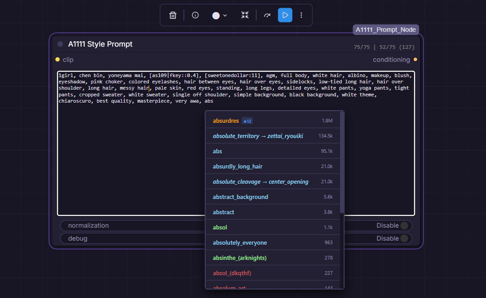
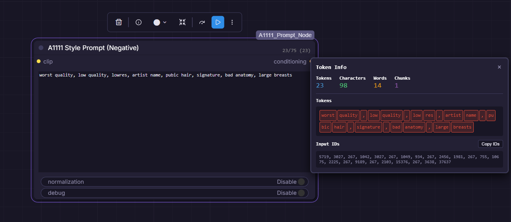
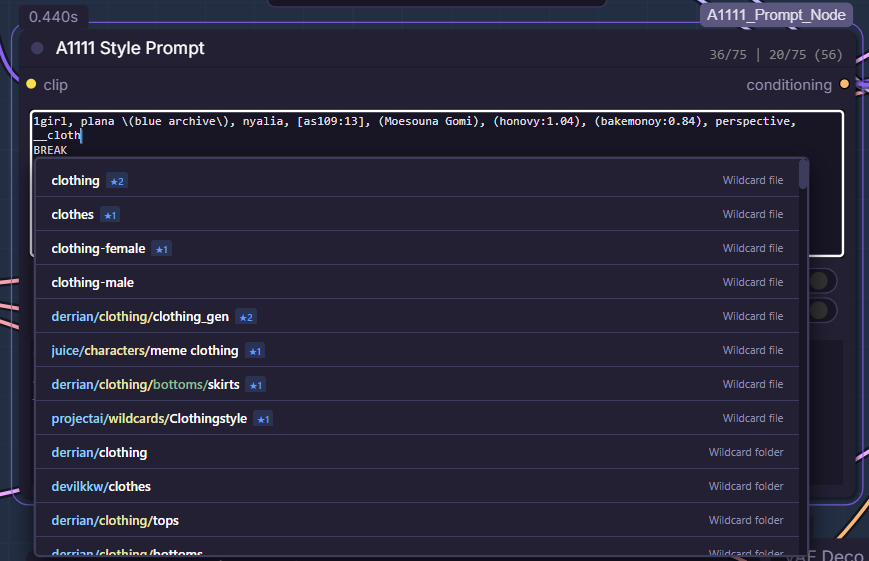
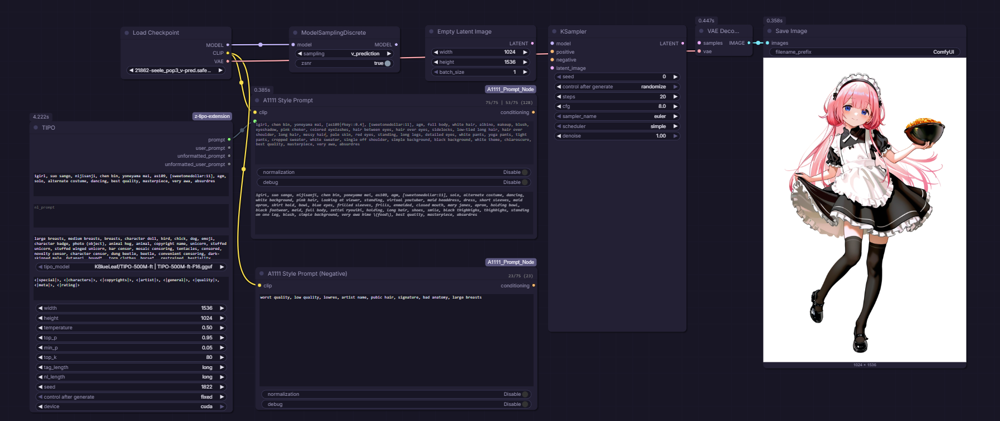

# A1111 Prompt Node

A custom ComfyUI node with **A1111-style prompt syntax**, wildcard expansion,
CLIP scheduling and alternation, and model-aware emphasis for SD1.5, SDXL and Anima.

## Installation

Place this repository inside `ComfyUI/custom_nodes/`. From the repository directory,
install dependencies using the Python environment that runs ComfyUI:

```bash
python -m pip install -r requirements.txt
```

Restart ComfyUI and refresh the browser after installing or updating. Anima
Attention mode needs ComfyUI's Cosmos attention-patch and attention-override APIs;
older installations should use Native mode or update ComfyUI.

## Features

### Positive prompt node



### Negative prompt node



### Autocomplete/Wildcards



### Full setup with optional TIPO support



### Core Features

- **CLIP chunking**: Encodes chunks of 75 content tokens plus special tokens
- **Direct CLIP emphasis**: Uses `z * weight` with optional mean rescaling; high weights can still produce artifacts
- **CLIP BREAK support**: Each BREAK segment is tokenized separately before encoding; this does not guarantee isolation in the diffusion model
- **Emphasis**: `(text:1.2)`, `(text)`, `[text]`
- **Wildcard support**: Resolves `__wildcard__` files from `data/wildcards`, including nested wildcard chains and dynamic prompt choices inside wildcard files
- **TIPO support**: TIPO prompt output can connect directly into the node, which shows the generated prompt it receives. Use [my fork](https://github.com/Enferlain/z-tipo-extension/tree/custom) to expand connected A1111 wildcards before the single TIPO generation pass and preserve weighting emphasis in A1111 syntax.

### Encoder compatibility

SD1.5 and SDXL use the CLIP chunking and direct emphasis scaling described above.
The current SDXL schedule switches token embeddings but retains the first
prompt's pooled conditioning vector; switching that vector remains unsupported.

Static Anima prompts use ComfyUI's native Qwen encoding and retain the attention
mask, T5 token IDs, and T5 emphasis weights required by its conditioning adapter.
There is no T5 encoder running. Both prompt nodes offer an `anima_emphasis` option:

| Mode | Behavior |
| --- | --- |
| `native` (default) | ComfyUI's existing Anima tokenization and conditioning weights, including fragment tokenization. Existing workflows keep this behavior. |
| `single_pass` | Tokenize the complete prompt once, then scale the weighted T5-token conditioning vectors. Neutral `:1` syntax preserves plain conditioning. |
| `attention` | Use single-pass tokenization, keep conditioning vectors unscaled, and bias cross-attention toward weighted tokens after key normalization. |

These choices apply only to Anima; keep `native` for SD1.5/SDXL. Attention mode
travels with conditioning, so no extra model input is needed, and positive and
negative prompts can choose modes independently. Attention mode requires finite,
strictly positive weights; use native/single-pass for zero or negative weights.
Single-pass and attention modes do not support textual-inversion embeddings.
Tokens spanning differently weighted text use the average non-whitespace character
weight; special tokens remain neutral. Attention requires a current ComfyUI with
Cosmos attention patches and attention-override support.

The same number means different operations across modes. Attention can be subtler
and may produce fewer signature-like artifacts for some artist tags; it is not a
guarantee of watermark suppression or equal style strength. See the
[five-seed investigation](research/SILVERMOON_MULTISEED_FINDINGS.md).

Anima `BREAK` and normalization produce explicit errors. The positive node also
rejects scheduling/alternation; the negative node keeps its existing first-step
fallback instead of applying a schedule. Separately encoding fragments before the adapter
does not establish end-to-end isolation. The current scheduling hook cannot
safely switch Anima's token-dependent conditioning.
The live token counter still estimates CLIP chunks; it does not report Anima lengths.

Encoder/model policy lives in the [`encoding` package](encoding/README.md), shared
by both prompt nodes. Its CLIP and Anima implementations declare their supported
operations; unknown token streams are rejected instead of treated as CLIP.

### Token Counter

The node displays a **live token count** in the header, showing tokens per 77-token sequence:

```
45/75 | 32/75
```

- Each number shows tokens in that sequence (max 75 usable per sequence)
- BREAK creates new sequences: `dog, cat BREAK bird` → `6/75 | 1/75`
- Updates in real-time as you type
- Estimates CLIP token chunks; it does not measure the connected Anima encoder's sequence length
- Clickable for breakdown and input ids

**Warning Colors:**

- **Gray** (default): Normal prompt length
- **Yellow/Orange**: 300+ total tokens (4+ chunks) - getting long
- **Red**: 450+ total tokens (6+ chunks) - may impact quality/memory

**Boundary Markers:**

- Orange vertical bars appear in the text where 75-token chunk boundaries fall
- Blue vertical bars mark BREAK positions
- Markers align with word boundaries and update in real-time

### Tag Autocomplete

The node includes [**A1111-style tag autocomplete**](https://github.com/DominikDoom/a1111-sd-webui-tagcomplete) functionality:

- **Trigger**: Start typing any tag (2+ characters)
- **Database**: Uses `danbooru_e621_merged_2026-03-01_pt20-ia-dd-ed-spc.csv` by default, with additional Danbooru/E621 databases bundled. See [database configuration](data/tags/README.md).
- **Search**: Matches tag names and aliases
- **Navigation**: Use ↑/↓ arrows, Tab/Enter to select, Escape to close
- **Color coding**: Tags are colored by type (general, artist, character, etc.)
- **Post counts**: Shows tag popularity for better selection
- **Frequency sorting**: Your frequently used tags appear first with a ★ indicator
- **Theme support**: Automatically adapts to ComfyUI's theme (dark/light/custom)

**Features:**

- Alias support: Type `sole_female` → suggests `1girl`
- Smart insertion: Automatically adds commas and handles spacing
- Parenthesis escaping: `name_(artist)` → `name_\(artist\)`
- Real-time search with 50ms debouncing
- Usage tracking: Tags you use often are prioritized in results
- Quality tags: Automatically includes `extra-quality-tags.csv` for common quality/style tags
- Theme-aware: Respects your ComfyUI color scheme

### Wildcard Support

The node supports **A1111-style wildcard files** stored in `data/wildcards/`.

- **Basic syntax**: `__outfits__`
- **Nested folders**: `__characters/anime__`
- **Nested expansion**: wildcard files can reference other wildcard files
- **Dynamic prompt choices inside wildcard files**:
  - `{red|blue}`
  - `{1-2$$ring|necklace|bracelet}`
  - `{20%hat|scarf}`

**Autocomplete integration:**

- Type `__` to browse wildcard folders and files
- Selecting a wildcard file inserts the concise `__leaf__` name when it is unique, or the full `__path/to/file__` when needed to disambiguate duplicate leaf names
- After selecting a wildcard file, the popup stays open and can show the file's contents for quick follow-up selection
- The complete wildcard path list is loaded once and filtered locally for consistent typing latency

**Notes:**

- Wildcard files are plain `.txt` files under `data/wildcards/`
- Blank lines and `#` comment lines are ignored
- Prompt spacing is normalized after expansion so optional empty branches do not leave doubled spaces behind

**Bundled tag databases:**

- `danbooru.csv` - Alternative Danbooru database
- `e621.csv` - E621 database (furry-focused)
- `danbooru_e621_merged_*.csv` - Larger merged Danbooru/E621 databases
- `extra-quality-tags.csv` - Quality and style tags (auto-loaded)
- Custom CSV files can be added to `data/tags/`; the current autocomplete UI uses the configured backend default and does not expose a database selector

**Frequency Management:**
Open browser console and use:

- `window.A1111Autocomplete.getStats()` - View your most used tags
- `window.A1111Autocomplete.resetFrequency()` - Clear usage data
- `window.A1111Autocomplete.exportFrequency()` - Backup your data

### Scheduling (positive CLIP prompts)

| Syntax          | Meaning                           | Auto-detects? |
| --------------- | --------------------------------- | ------------- |
| `[cat:dog:0.5]` | Switch from "cat" to "dog" at 50% | Yes           |
| `[cat:dog:10]`  | Switch at step 10 (literal count) | Yes           |
| `[glasses:0.5]` | Add "glasses" at 50%              | Yes           |
| `[glasses:10]`  | Add at step 10                    | Yes           |
| `[hat::0.7]`    | Remove "hat" at 70%               | Yes           |
| `[hat::15]`     | Remove at step 15                 | Yes           |

**Note**: The node automatically detects the total step count from your connected Sampler or Scheduler.

**Important**:

- **Steps are automatic**: You do not need to manually set a step count; the node traverses the workflow graph to find the connected Sampler/Scheduler.
- **Scaling**:
  - **Percentages** (e.g., `0.5`) scale proportionally to any sampler step count.
  - **Integers** (e.g., `10`) are tied to the detected step count. If the sampler steps are changed after encoding, the node automatically scales the transition point to maintain the same relative timing.

**Nested syntax supported:**

```
[honovy, exsys:chen bin, [as109|fkey], [sweetonedollar:11]:0.4]
```

### Alternation

| Syntax           | Meaning                                           |
| ---------------- | ------------------------------------------------- |
| `[white\|black]` | Switches per-step (step 1=white, step 2=black...) |
| `[A\|B\|C]`      | Cycles through options each step                  |
| `[A\|]`          | Alternates between A and nothing                  |

### Scheduled Alternation (Extension)

Control when alternation starts or stops:

| Syntax               | Meaning                                   |
| -------------------- | ----------------------------------------- |
| `[as109\|fkey::0.6]` | Alternate until 60%, then as109           |
| `[as109\|fkey:0.4]`  | as109 until 40%, then start alternating   |
| `[as109\|fkey::15]`  | Alternate until step 15, then as109       |

> [!TIP]
> **Matching A1111/Forge multi-evaluation sampler behavior:** A1111/Forge can
> advance prompt scheduling once per denoiser evaluation rather than once per
> displayed sampler step. With a sampler that performs two evaluations per
> step, a 28-step alternation can therefore end around displayed step 14 and
> settle on its first option. To reproduce that effective result here, use a
> scheduled cutoff such as `[A|B::0.5]`: alternate for the first half, then
> keep `A`. A plain `[A|B]` continues across the full ComfyUI denoising
> schedule.

**Combining with scheduling to lock to a value:**

```
[as109|fkey::0.6][:as109:0.6]
```

This alternates until 60%, then switches to just "as109".

### Model Support

- **SDXL**: Dual CLIP (clip_l + clip_g) with independent weight scaling
- **SD1.5**: Full support
- **Anima**: Static prompts with Native, Single-pass, or Attention emphasis; see [encoder compatibility](#encoder-compatibility) for limits

### What is Normalization?

For SD1.5/SDXL, emphasis directly multiplies conditioning vectors. Anima uses the
selected `anima_emphasis` mode instead. Normalization is unsupported for Anima.

The `normalization` toggle specifically controls A1111's **Mean Rescaling** (Norm vs No Norm):

**When `normalization` is enabled (True):**

- **Mean rescaling**: Rescales the final conditioning to match the original arithmetic mean, provided the weighted mean is not near zero. This is not RMS/energy normalization.
- **Effect**: Changes overall conditioning scale and may affect saturation; it does not guarantee artifact-free high weights.
- **Commonly used with**: **SD1.5** and models sensitive to high prompt energy.

**When `normalization` is disabled (False - Default):**

- **Match A1111 "No Norm"**: Applies weights exactly as written without any rescaling.
- **Effect**: Emphasized words "punch" through more aggressively.
- **Commonly used with**: **SDXL** and modern models that handle high energy well.

---

## Usage

This pack provides **two nodes**:

| Node                              | Use Case                                          |
| --------------------------------- | ------------------------------------------------- |
| **A1111 Style Prompt**            | Positive prompt (supports alternation/scheduling) |
| **A1111 Style Prompt (Negative)** | Negative prompt (no alternation support)          |

### A1111 Style Prompt (Positive)

#### Inputs

| Input         | Type   | Required | Description                                      |
| ------------- | ------ | -------- | ------------------------------------------------ |
| clip          | CLIP   | Yes      | The CLIP model                                   |
| text          | STRING | Yes      | Prompt with A1111 syntax                         |
| normalization | BOOL   | No       | EmphasisOriginal/EmphasisOriginalNoNorm toggle   |
| debug         | BOOL   | No       | Show detailed schedule information               |
| anima_emphasis | COMBO | No       | Anima only: `native` (default), `single_pass`, or `attention` |

#### Outputs

| Output       | Type         | Description              |
| ------------ | ------------ | ------------------------ |
| conditioning | CONDITIONING | The encoded conditioning |

**Important**:

- **Auto-detection**: The node detects steps from the downstream sampler. If no sampler is connected, step-based syntax (`[a:b:10]`) will raise an error.
- **Flexibility**: Use percentage syntax (`[a:b:0.5]`) for the most portable prompts.
- **Effective prompt preview**: When TIPO or wildcards expand the text, the node shows the resolved prompt in the UI so you can see what was actually encoded. Its compact toggle preserves the expanded or collapsed state between executions.

### A1111 Style Prompt (Negative)

#### Inputs

The same visible inputs as the positive node. Neither node requires a MODEL input.

#### Outputs

| Output       | Type         | Description              |
| ------------ | ------------ | ------------------------ |
| conditioning | CONDITIONING | The encoded conditioning |

> **Note:** If scheduling/alternation syntax is used in the negative node, it will use the **first step's prompt only** and log an informational message.

### Workflow

Use these nodes in supported SD1.5, SDXL and Anima workflows:

```text
        ┌─────────────────────────────┐
CLIP  ──┤  [A1111 Style Prompt]       ├──► CONDITIONING ──► Sampler (positive)
        └─────────────────────────────┘

        ┌─────────────────────────────┐
CLIP  ──┤  [A1111 Style Prompt (Neg)] ├──► CONDITIONING ──► Sampler (negative)
        └─────────────────────────────┘
```

**Alternation and scheduling work automatically** - no MODEL connection needed! The node uses ComfyUI's hook system to access step information during sampling.

---

## Examples

```
# Basic emphasis
a (beautiful:1.3) landscape

# BREAK for isolation
artist name BREAK character name, wearing a hat

# Step-based scheduling (with steps=28)
[mountains:ocean:14] at sunset

# Alternation (no MODEL connection needed)
1girl, [as109|fkey], detailed

# Add element at specific step
1girl, [sweetonedollar:11], high quality

# Nested scheduling with alternation
1girl, [honovy:chen bin, [as109|fkey]:0.4]

# Scheduled alternation - stop at 60%
1girl, [as109|fkey::0.6], detailed

# Combined
(epic:1.2) [forest:city:0.3] BREAK detailed background
```

---

## Debug Mode

Enable the `debug` input to see detailed information:

```
[A1111 Prompt] Unique prompts: 4 (will encode each once)
[A1111 Prompt] Step transitions: 27 across 28 steps
[A1111 Prompt] Alternation pattern sample:
  Step 0: 1girl, chen bin, yoneyama mai, as109, , agm...
  Step 1: 1girl, chen bin, yoneyama mai, fkey, , agm...
  Step 2: 1girl, chen bin, yoneyama mai, as109, , agm...
```

---

## Technical Notes

### How Scheduling Works

The node uses ComfyUI's `TransformerOptionsHook` system to swap conditioning per-step:

- All unique prompts are encoded once (efficient caching)
- Per-step embeddings are stored in a hook attached to the conditioning
- During sampling, the hook receives `sample_sigmas` from the sampler
- The hook calculates the current step and swaps to the appropriate embedding
- This works with any sampler/scheduler automatically

### Hidden Inputs (used for auto-detection)

- `prompt`: Receives the full workflow graph structure.
- `unique_id`: Receives the node's unique ID used to traverse the graph starting from itself.

### Step Parameter Behavior

The visible inputs are `clip`, `text`, `normalization`, `debug`, and
`anima_emphasis`. For supported CLIP encoders, scheduling is managed as follows:

1. **Auto-detection**: The node automatically detects the total step count from the connected sampler/scheduler downstream.
2. **Step-based syntax**: Syntax like `[thing:10]` (using integers) is relative to the detected count. The node scales these points automatically if the sampler step count changes during sampling to ensure consistent timing.
3. **Percentage-based syntax**: Syntax like `[thing:0.5]` (using decimals) is the recommended way to ensure your prompt behaves identically across different step counts.

### Known Limitations

1. **Alternation is positive-only**: Only the main node supports alternation. The negative node will use the first step's prompt if scheduling syntax is present.

2. **Automatic Scaling**: Unlike A1111 (where steps are manual), this node provides **automatic scaling**. If you write `[thing:10]` for a 20-step run but later change it to 30 steps, the node will automatically move the transition to step 15 to preserve the 50% relative timing. Use percentage syntax `[thing:0.5]` for the most explicit control.

3. **Visual parity**: This node follows ComfyUI's denoising progress, while A1111/Forge can advance prompt scheduling per denoiser evaluation on multi-evaluation samplers. Plain schedules can therefore differ when A1111/Forge exhausts them early. Use a scheduled cutoff such as `[a|b::0.5]` when you intentionally want that halfway behavior. The visual effect may still differ due to architectural differences:
   - A1111 applies conditioning at the CFGDenoiser level (before model call)
   - This node applies conditioning through ComfyUI's hook system during sampling

4. **Schedule indexing**: A known step-index mapping issue can repeat a scheduled entry and skip the final one. Exact per-step timing remains unqualified; see the [retained schedule probe](research/ANIMA_EMPHASIS_FINDINGS.md).

Use the **scheduled alternation** syntax (`[a|b::0.6]`) if you need to control exactly when alternation stops.

---

## Performance

- **Shared Wildcard Catalog**: Wildcard paths are scanned once during startup and reused by autocomplete and runtime expansion.
- **Efficient encoding**: Encodings are cached using the encoder instance, text, normalization, and Anima emphasis mode.
- **GPU Pre-Allocation**: All embeddings are pre-moved to the GPU (`intermediate_device`) during encoding to eliminate device-transfer latency during the sampling loop.
- **Shared Hook Caching**: The step-swapping hook uses a structural result cache that persists when the hook is cloned, avoiding repeated conditioning tensor construction across sampling calls.
- **Optimized Padding**: Tensors are padded only to the lengths used within the current generation, preventing global cache bloat.
- **Direct Memory Swapping**: If prompts have identical sequence lengths, the hook uses a zero-math "fast-path" to swap embeddings instantly.
- **Batch Processing**: Multiple BREAK segments are batched into a single encoding pass.

## Development and research

Model-specific behavior lives in [`encoding/`](encoding/README.md). The
[`research/`](research/README.md) directory contains reproducible experiments and
findings; generated images and tensors remain local and are ignored by Git.
Older design notes are preserved in [`docs/archive/`](docs/archive/README.md).
Current work is tracked with Beads (`bd ready`, `bd list --status=open`).

Run Python test files separately to isolate their ComfyUI mocks:

```bash
python -m unittest discover -s tests -p test_anima_modes.py
node --test tests/test_autocomplete_lifecycle.cjs
```

Run the other `tests/test_*.py` files individually in ComfyUI's Python environment.
Live model validation is available via `python -X utf8 research/verify_anima_modes.py`;
its model paths are local defaults that may need adjusting.

---

[](https://deepwiki.com/Enferlain/ComfyUI-A1111-cond)
